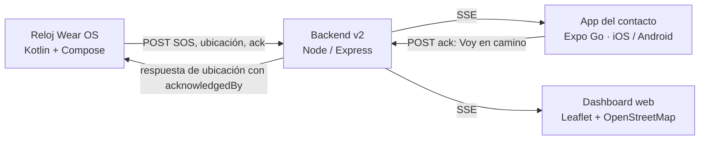

# SOS Wear

Prototipo educativo de asistencia SOS compuesto por un reloj Wear OS, un backend Node/Express v2 y una app Expo para el contacto. El reloj comunica una emergencia y su ubicación; el backend la distribuye en tiempo real al dashboard y al contacto, quien puede confirmar que va en camino.



El backend conserva emergencias en memoria durante su ejecución: reiniciarlo elimina el estado. No se requiere base de datos.

## Requisitos

- Node.js 20 o posterior y npm.
- App de contacto: Expo SDK 57 y Expo Go compatible; iPhone y PC en la misma red Wi-Fi (o un túnel de Expo).
- Reloj: Android Studio, Android SDK, emulador **Wear OS Small Round API 34** y Temurin JDK 21 en `C:\Users\Vlad-pc\.jdks\temurin-21.0.12.1`.
- Para compilar en este equipo: `ANDROID_HOME=C:\Users\Vlad-pc\AppData\Local\Android\Sdk`.
- Conexión a Internet para descargar Leaflet y los mosaicos de OpenStreetMap.

## Cómo ejecutar cada pieza

### Backend y dashboard

Desde la raíz del repositorio, en PowerShell:

```powershell
npm --prefix backend install
npm --prefix backend start
```

Abre [http://localhost:3000/dashboard](http://localhost:3000/dashboard) en el PC. El backend escucha en `0.0.0.0:3000`; el dashboard usa SSE y recurre a polling si pierde el flujo.

### App del contacto con Expo Go

1. Instala las dependencias: `npm --prefix contacto install`.
2. Inicia sesión en Expo desde la carpeta `contacto` con `npx expo login`.
3. Configura en la app la URL del backend con la IP privada del PC, por ejemplo `http://192.168.1.42:3000`. En iPhone, `localhost` apuntaría al teléfono, no al PC.
4. En la misma carpeta ejecuta `npx expo start --lan` y escanea el QR con Expo Go. Si la red impide conexiones LAN, usa `npx expo start --tunnel`.
5. Permite las notificaciones locales si quieres recibir el aviso del sistema.

Para obtener la IP del PC, ejecuta `ipconfig` y usa la dirección IPv4 del adaptador Wi-Fi. El iPhone y el PC deben estar en la misma red y no aislados por una red de invitados o VPN. Si Windows Firewall bloquea la conexión, permite Node.js en redes privadas o crea una regla de entrada limitada al puerto 3000 (PowerShell como administrador):

```powershell
New-NetFirewallRule -DisplayName "SOS Wear Backend 3000" -Direction Inbound -Protocol TCP -LocalPort 3000 -Action Allow -Profile Private
```

El emulador Android usa `http://10.0.2.2:3000` para acceder al PC anfitrión; el teléfono físico debe usar la IP LAN del PC.

### Reloj Wear OS en el emulador

1. Abre la raíz del proyecto en Android Studio y espera la sincronización de Gradle.
2. Inicia o crea un emulador **Wear OS Small Round API 34**.
3. En PowerShell desde la raíz, configura las rutas obligatorias y compila:

   ```powershell
   $env:JAVA_HOME = 'C:\Users\Vlad-pc\.jdks\temurin-21.0.12.1'
   $env:ANDROID_HOME = 'C:\Users\Vlad-pc\AppData\Local\Android\Sdk'
   $env:PATH = "$env:JAVA_HOME\bin;$env:ANDROID_HOME\platform-tools;$env:PATH"
   .\gradlew.bat assembleDebug
   ```

4. Ejecuta la configuración `app` en el emulador y concede ubicación precisa y notificaciones. El SOS manual solicita la ubicación al terminar su cuenta regresiva.
5. Para usar una ruta simulada, abre **Extended Controls > Location**, carga [`test/ruta_prueba.gpx`](test/ruta_prueba.gpx) y pulsa **Play**. Para fijar la ubicación de la UTSLRC desde ADB:

   ```powershell
   adb emu geo fix -114.71727561714322 32.43786004187378
   ```

En un emulador que requiera activar Wi-Fi, consulta su serial con `adb devices` y ejecuta `adb -s <serial> shell svc wifi enable`.

## Contrato API v2

Base local: `http://<IP-del-PC>:3000`. Los JSON de error conservan el formato `{ "error": "..." }`. El campo `trigger` se añadió de forma aditiva: se acepta en `POST /api/sos`, es opcional, y si se omite se interpreta como `manual`. Sus únicos valores son `manual`, `voz`, `pulso` y `carrera`; un valor distinto responde HTTP 400.

| Método y ruta | Entrada principal | Resultado |
|---|---|---|
| `POST /api/sos` | `id?`, `name`, `lat`, `lng`, `timestamp`, `accuracy?`, `trigger?` | HTTP 201 y emergencia activa con `trigger`, `track` inicial, `acknowledgedBy: null` y demás datos. |
| `POST /api/sos/:id/location` | `lat`, `lng`, `timestamp`, `accuracy?` | Actualiza coordenadas y rastro; devuelve la emergencia completa, incluido `trigger` y `acknowledgedBy` (`string` o `null`). |
| `POST /api/sos/:id/ack` | `contactName` | Registra o actualiza `acknowledgedBy` y `acknowledgedAt`; devuelve la emergencia completa. |
| `POST /api/sos/:id/cancel` | Sin campos obligatorios | Finaliza la emergencia y devuelve la emergencia completa. |
| `GET /api/sos/active` | — | `{ emergencies, finalized }`; las activas y finalizadas mantienen `trigger`. |
| `GET /api/sos/stream` | — | SSE: `snapshot`, `sos-created`, `sos-location`, `sos-ack`, `sos-finalized`; cada evento contiene la emergencia, incluido `trigger`. |

Las coordenadas deben ser válidas, `timestamp` debe ser una fecha parseable y `accuracy` opcional no puede ser negativo. Cada emergencia mantiene hasta 300 puntos `{ lat, lng, accuracy, timestamp }`. `acknowledgedBy` y `acknowledgedAt` pueden ser nulos.

Para simular SOS/rastro desde PowerShell: `.\scripts\simular-sos.ps1`. Acepta `-Url`, `-Nombre`, `-Puntos`, `-Intervalo` y `-Trigger` (`manual` por defecto; permite `manual`, `voz`, `pulso` o `carrera`).

## Detección automática del reloj

Las tres detecciones se guardan en DataStore y empiezan **apagadas**. Ninguna activa el SOS sin aviso: cada disparo entra a la cuenta regresiva de **10 segundos**, muestra el motivo y permite cancelar con vibración; el SOS manual conserva su cuenta de **5 segundos**. Al confirmar, el backend recibe el `trigger` correspondiente.

| Detección | Regla implementada |
|---|---|
| Voz: auxilio | `SpeechRecognizer` escucha en español y reinicia después de cada resultado/error. Reconoce “auxilio”, “socorro” o “ayuda”, ignorando mayúsculas y acentos. Usa un servicio en primer plano con notificación mientras está habilitada. |
| Pulso anómalo | En reposo (cadencia menor a 40 pasos/min), pulso mayor de 140 o menor de 40 bpm durante 20 s continuos. Requiere `TYPE_HEART_RATE`; no es diagnóstico médico. |
| Carrera | Cadencia mayor de 150 pasos/min durante 20 s; además requiere pulso mayor de 120 bpm cuando hay sensor cardíaco disponible. El prototipo no integra sesiones externas de ejercicio. |

Tras cancelar una detección, el mismo tipo queda en espera durante 2 minutos. En **Configuración > Detección automática** están los interruptores y los botones permanentes **Simular: auxilio**, **Simular: pulso anómalo** y **Simular: carrera**. Las simulaciones recorren la misma cuenta regresiva sin hablar ni correr. El texto de aviso se mantiene visible: **“Prototipo educativo. No es un dispositivo médico.”**

La detección de voz requiere permiso de micrófono y un servicio de reconocimiento instalado; pulso y carrera dependen de los sensores del reloj/emulador y sus permisos. Si no hay reconocimiento o sensor compatible, la app lo indica. No se ha verificado voz ni sensores en el emulador de esta entrega: usa **MODO PRUEBA** para demostrar el flujo sin afirmar que esos sensores funcionan.

## Limitaciones

- Expo Go puede suspender el JavaScript/SSE al pasar a segundo plano o al cerrar la app; no es una app nativa de producción con entrega garantizada en segundo plano.
- El botón **Llamar** abre el marcador del teléfono con `tel:`; no hay servicio externo ni llamada automática. **Cómo llegar** abre una URL de mapas.
- Voz y sensores dependen del hardware, permisos y servicios disponibles; el modo prueba valida la cuenta regresiva, no el reconocimiento ni la medición.
- Una interrupción de red puede retrasar la sincronización; el reloj conserva operaciones pendientes mientras el servicio SOS sigue ejecutándose.
- El backend guarda todo en memoria y no autentica usuarios. Úsalo solo en una red de prueba confiable; no expongas el puerto a Internet.
- El mapa requiere Internet y OpenStreetMap/Leaflet disponibles.

## Checklist de pruebas

- [ ] Inicio SOS manual: 5 s, cancelar no crea emergencia y confirmar envía `trigger: manual`.
- [ ] Simular auxilio, pulso anómalo y carrera: cada botón muestra su motivo, cuenta 10 s y permite cancelar.
- [ ] Activar y desactivar cada detección, reiniciar la app y confirmar persistencia; verificar permisos y notificación visible.
- [ ] Con `-Trigger carrera`, verificar que el backend, SSE, contacto y dashboard muestran el motivo correcto.
- [ ] El contacto recibe el SOS y la notificación local muestra el motivo.
- [ ] **Voy en camino** actualiza la app/dashboard y el reloj muestra el nombre; comprobar una sola respuesta háptica por emergencia.
- [ ] Detener el SOS en el reloj: aparece como finalizado en el contacto y dashboard.
- [ ] Con backend desconectado, observar reintento del reloj y reconexión del dashboard.
- [ ] Probar diseño en Wear OS Small Round y en el iPhone, incluyendo safe areas y estados vacíos.
- [ ] Probar voz y sensores en hardware compatible; registrar si el reconocimiento/sensor no está disponible.

## Guion breve para grabar la demostración (10 pasos)

1. Presenta el reloj, el iPhone y el dashboard abiertos; muestra que no hay alertas.
2. Explica que el backend local conecta las tres superficies.
3. En el reloj abre **Configuración > Detección automática** y señala que todo está apagado.
4. Pulsa **Simular: auxilio** y muestra el motivo y la cuenta regresiva de 10 segundos.
5. Cancela una simulación para demostrar que no se envía un SOS antes de confirmar.
6. Repite la simulación y deja terminar la cuenta; muestra el SOS en reloj, app y dashboard.
7. Enseña el marcador, el rastro y el motivo de la emergencia en el dashboard.
8. En el iPhone pulsa **Voy en camino** y muestra el acuse en la app y el dashboard.
9. Vuelve al reloj, enseña “va en camino” y pulsa **Detener SOS**.
10. Muestra el estado final y recuerda que es un prototipo educativo no médico; voz/sensores no se presentan como verificados.

## Validación local

```powershell
npm --prefix backend test
$env:JAVA_HOME = 'C:\Users\Vlad-pc\.jdks\temurin-21.0.12.1'
$env:ANDROID_HOME = 'C:\Users\Vlad-pc\AppData\Local\Android\Sdk'
.\gradlew.bat assembleDebug
Push-Location contacto
npx tsc --noEmit
npx expo-doctor
npx expo export --platform ios --platform android
Pop-Location
```
